# Factory-to-Customer Shipping Route Efficiency Analysis

## Project Overview

This project explores factory assignments, customer geography, shipping modes, product distribution, financial patterns, and estimated factory-to-state distances using the Nassau Candy Distributor dataset.

## Dataset Overview

| Metric | Value |
|---|---:|
| Product-level records | 10,194 |
| Unique orders | 8,549 |
| Products | 15 |
| Mapped factories | 5 |
| Unmapped product records | 0 |
| Multi-factory orders | 0 |

Product-level records must not be interpreted as unique shipments.

## Technology Stack

- Python
- Pandas
- NumPy
- Matplotlib
- Seaborn
- Plotly
- Streamlit

## Project Workflow

1. Dataset inspection and preservation.
2. Data cleaning and validation.
3. Product-to-factory mapping.
4. Geographic distribution analysis.
5. Shipping-mode analysis.
6. Financial analysis.
7. Approximate distance estimation.
8. Date-quality investigation.
9. Visualization and reporting.

## Factory Distribution

| Factory | Product records |
|---|---:|
| Lot's O' Nuts | 5,692 |
| Wicked Choccy's | 4,152 |
| Secret Factory | 217 |
| The Other Factory | 100 |
| Sugar Shack | 33 |

## Date Quality Investigation

| Metric | Observed value |
|---|---|
| Order Date range | 2024-01-02 to 2025-12-31 |
| Ship Date range | 2026-06-30 to 2030-06-28 |
| Mean calculated lead time | 1,320.84 days |
| Median calculated lead time | 1,274 days |
| Lead times above 730 days | All records |

The cause of these unusual date patterns is unknown. These dates cannot establish actual shipping delays, transit time, or delivery performance.

## Geographic and Route Methodology

Factory coordinates and approximate state-centroid coordinates are used to estimate straight-line distances. These are not road distances, actual vehicle routes, or verified customer delivery distances.

## Data Visualizations

### factory distribution

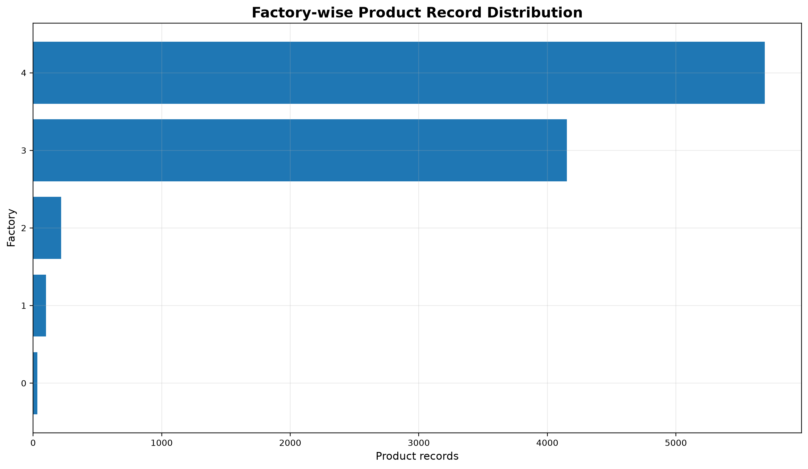

### us regional distribution

### country distribution

### shipping mode distribution

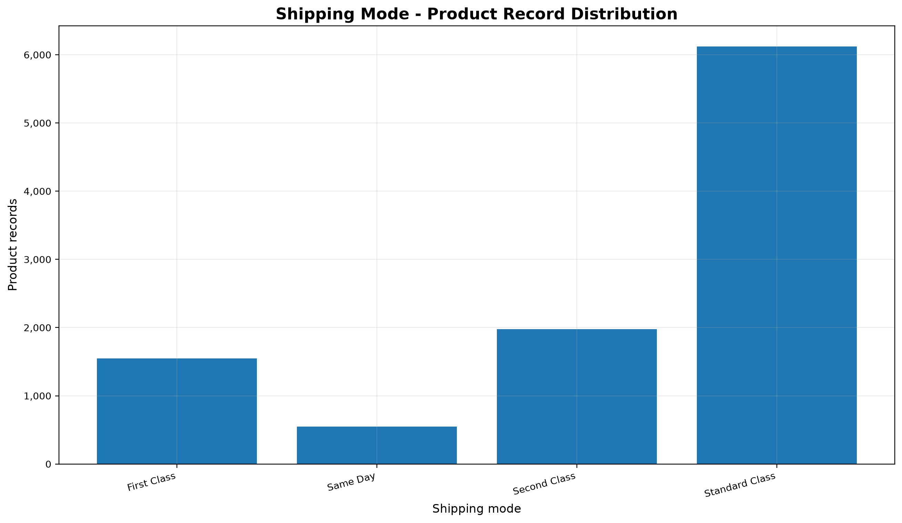

### product distribution

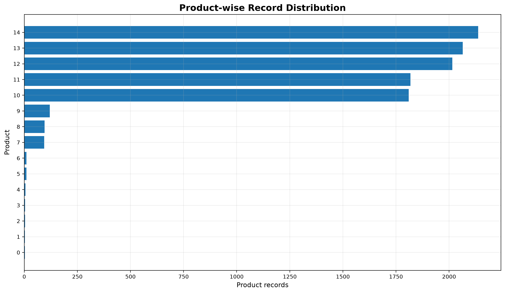

### factory region heatmap

### top factory state routes

### top us states

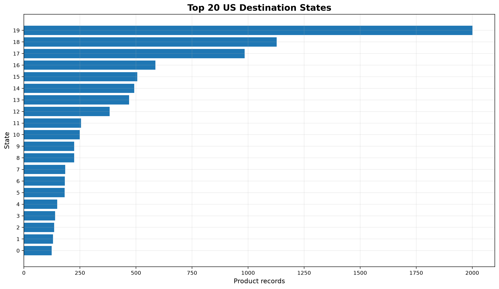

### us regional sales

### factory gross profit

### factory sales

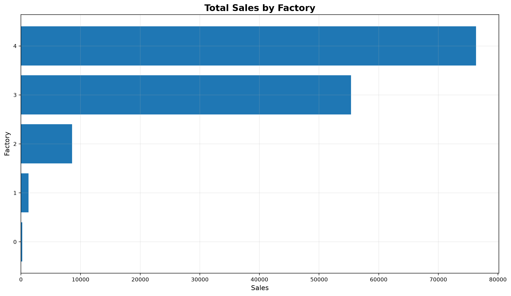

### factory profit margin

### sales vs cost

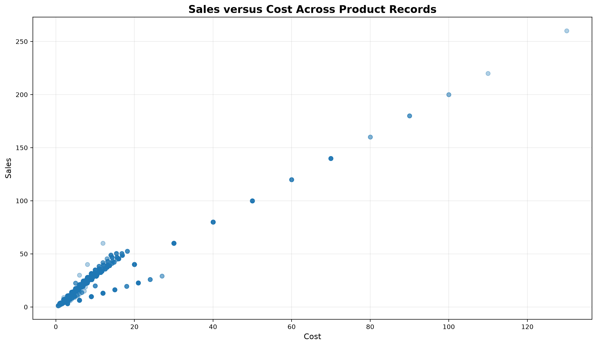

### monthly order volume

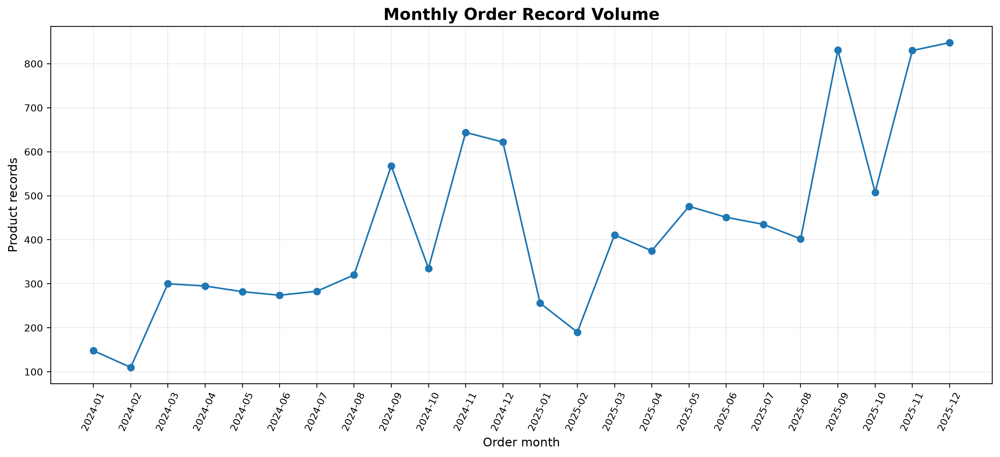

### factory units

### shipping mode sales

### date anomaly distribution

### date anomaly by year

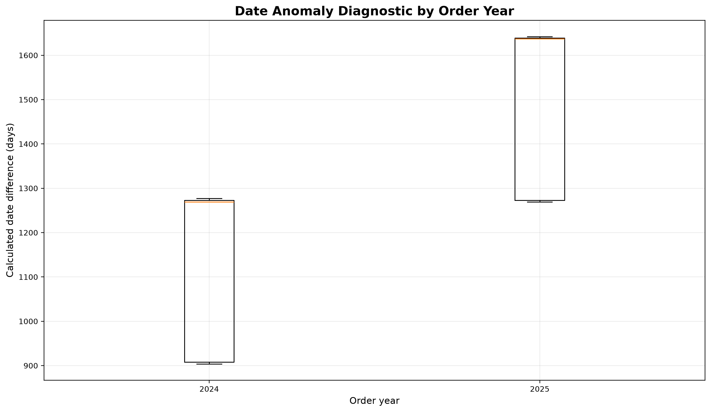

### regional gross profit

### units vs sales

### factory customer network map

### factory state distance heatmap

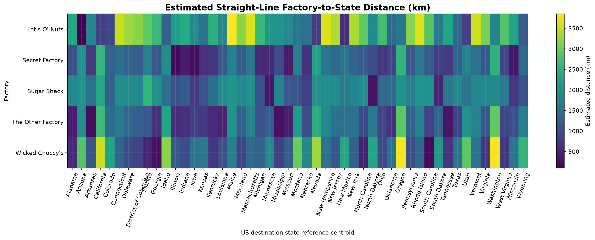

### factory region flow diagram

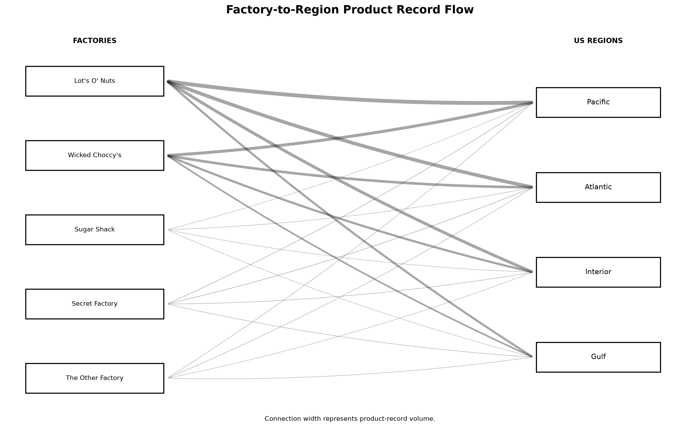

### factory state route pareto

### financial correlation heatmap

### top estimated factory state distances

## Project Diagrams

### diagram 01 project workflow

### diagram 02 data architecture

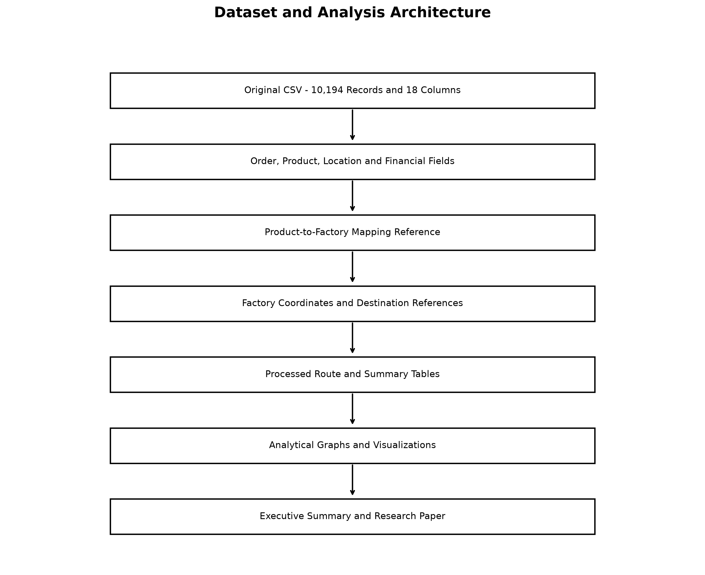

### diagram 03 route methodology

### diagram 04 date quality safeguard

## Interactive Streamlit Dashboard

Run locally:

    pip install -r dashboard/requirements.txt
    streamlit run dashboard/app.py

## Project Validation

Run:

    python tests/validate_project.py

## Limitations

- Product records are not shipment records.
- Customer delivery coordinates are unavailable.
- Distance estimates are approximate straight-line measurements.
- Date anomalies require source-system verification.
- Illustrative images do not verify actual company facilities.
- Actual delivery performance cannot be established from this dataset.

## Future Improvements

- Obtain verified customer coordinates.
- Integrate road-network routing.
- Validate dates against source-system records.
- Obtain shipment-level tracking information.
- Extend dashboard functionality and automated testing.

## Conclusion

This project provides an exploratory analysis of factory distribution, customer geography, shipping modes, financial patterns, and approximate geographic relationships in the supplied dataset.

**Domain:** Data Analytics | Supply Chain Analytics | Business Intelligence
