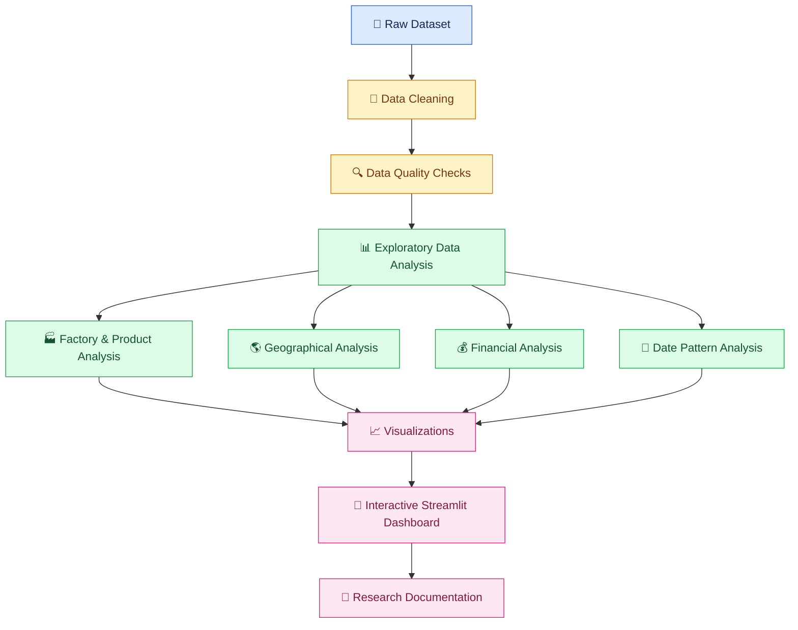
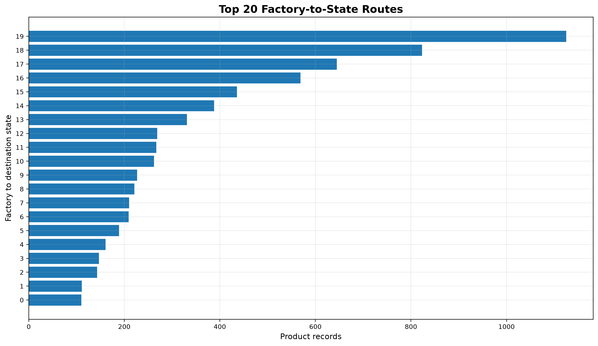
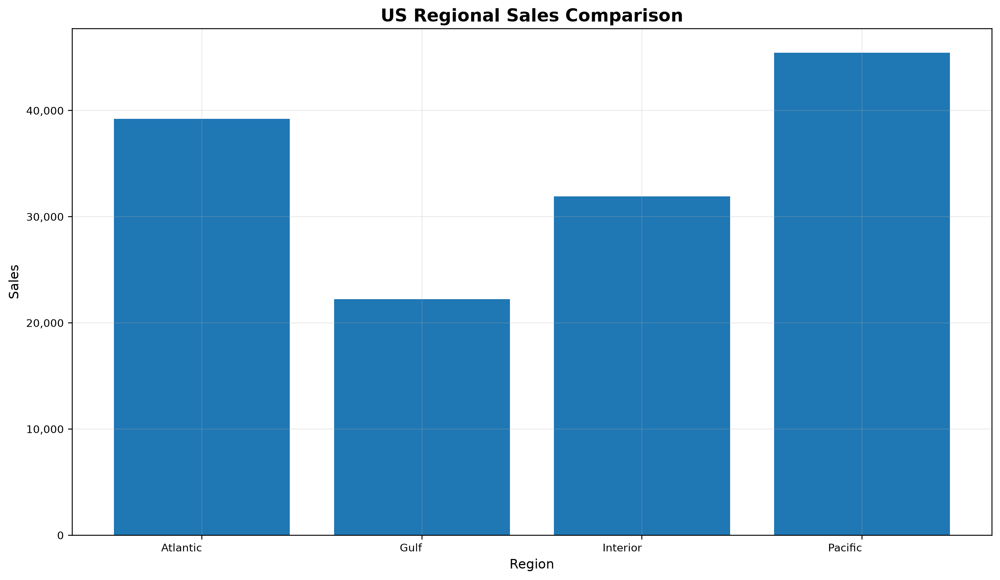
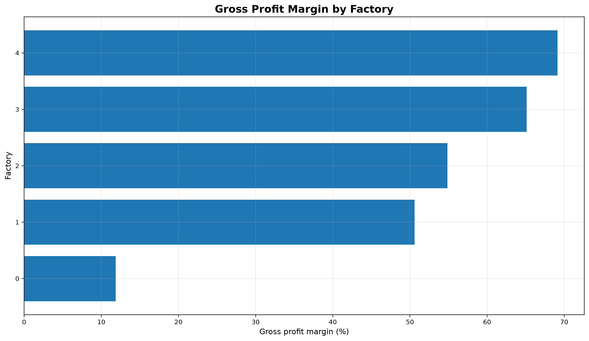
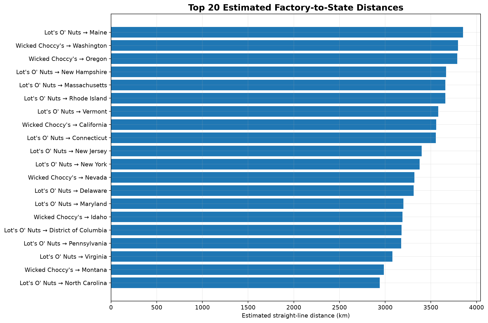
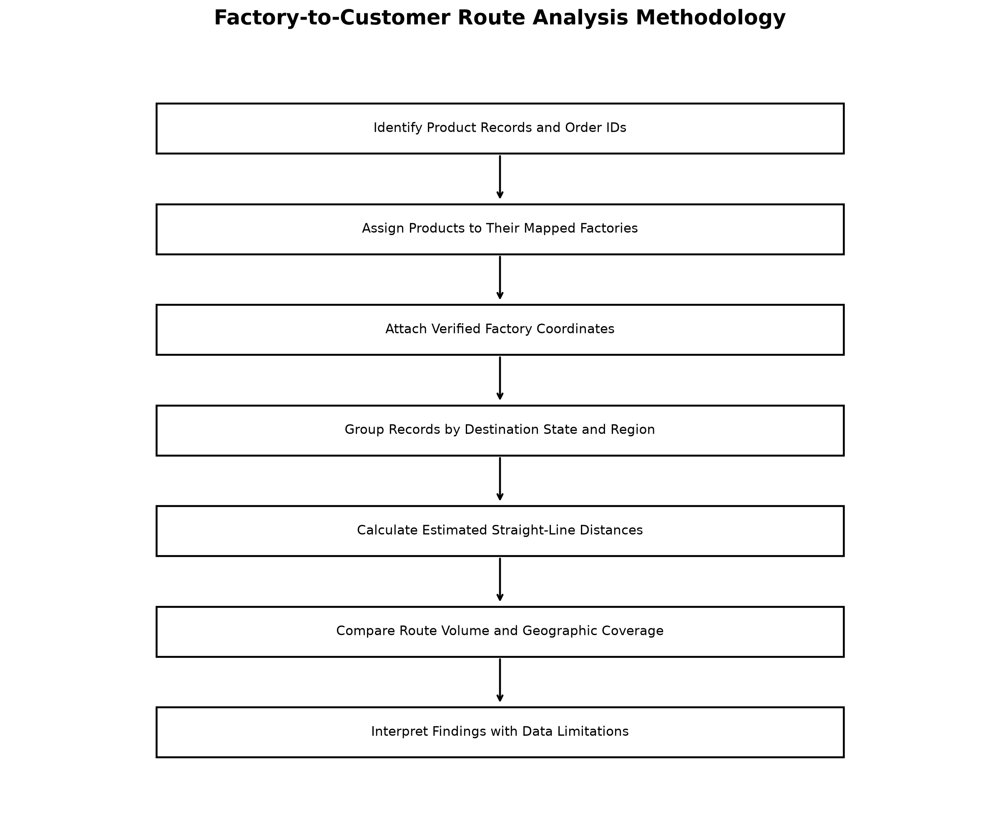

# 🍬 Factory-to-Customer Shipping Route Efficiency Analysis

<p align="center">
  
</p>

<p align="center">
  
  
  
  
  
</p>

<p align="center">
  <a href="https://pwer9ybbersbd3jfpgnazp.streamlit.app/">
    
  </a>
  <a href="research_paper/RESEARCH_PAPER.md">
    
  </a>
</p>

---

## 📌 Project Overview

The **Factory-to-Customer Shipping Route Efficiency Analysis** project explores supply chain and distribution data from Nassau Candy Distributor.

The project focuses on understanding factory distribution, customer geography, shipping modes, product distribution, sales, costs, gross profit, and approximate geographical distances between factories and customer states.

It combines Python-based data analysis, visualizations, data-quality checks, and an interactive Streamlit dashboard to make complex distribution data easier to explore.

## 🎯 Project Objectives

- Analyze product and order distribution across factories.
- Understand geographical distribution across US regions, states, and countries.
- Examine shipping-mode and product-level patterns.
- Compare factory-level sales, costs, and gross profit.
- Explore approximate factory-to-state geographical distances.
- Identify unusual date patterns and data-quality limitations.
- Present analytical findings through an interactive dashboard.

## 🚀 Live Interactive Dashboard

Explore the deployed Streamlit dashboard:

<p align="center">
  <a href="https://pwer9ybbersbd3jfpgnazp.streamlit.app/">
    
  </a>
</p>

The dashboard provides interactive access to the project's analytical visualizations and data exploration features.

## 🧰 Technology Stack

| Technology | Purpose |
|---|---|
| Python | Core programming and analysis |
| Pandas | Data cleaning and manipulation |
| NumPy | Numerical operations |
| Matplotlib | Data visualization |
| Seaborn | Statistical visualization |
| Streamlit | Interactive dashboard |
| Git & GitHub | Version control and project hosting |

## 📊 Dataset Overview

The analysis uses the Nassau Candy Distributor dataset.

| Metric | Value |
|---|---:|
| Product-level records | 10,194 |
| Unique orders | 8,549 |
| Products | 15 |
| Mapped factories | 5 |
| Unmapped product records | 0 |
| Multi-factory orders | 0 |

**Important:** Product-level records represent individual product records and should not be interpreted as unique shipments.

## 🏭 Factory Distribution

The dataset contains five mapped factories.

| Factory | Product Records |
|---|---:|
| Lot's O' Nuts | 5,692 |
| Wicked Choccy's | 4,152 |
| Secret Factory | 217 |
| The Other Factory | 100 |
| Sugar Shack | 33 |

## 🔄 Project Workflow



## 📈 Data Visualizations

The project includes **26 analytical charts and 4 supporting diagrams**.

### 1. Factory and Geographical Distribution

These visualizations explore factory distribution, regional coverage, country distribution, and factory-to-region patterns.

| Factory Distribution | US Regional Distribution |
|---|---|
|  |  |
| **Country Distribution** | **Shipping Mode Distribution** |
|  |  |
| **Product Distribution** | **Factory and Region Heatmap** |
|  |  |

### 2. Factory and State-Level Analysis

These charts examine factory-state relationships and the distribution of customer records across US states.

| Top Factory-State Routes | Top US States |
|---|---|
|  |  |

### 3. Sales, Profit and Financial Analysis

These visualizations compare regional sales, factory financial performance, gross profit, cost, and profit margins.

| US Regional Sales | Factory Gross Profit |
|---|---|
|  |  |
| **Factory Sales** | **Factory Profit Margin** |
|  |  |
| **Sales vs Cost** | **Regional Gross Profit** |
|  |  |

### 4. Order, Units and Shipping Patterns

These charts explore monthly order volume, factory units, shipping-mode sales, and relationships between units and sales.

| Monthly Order Volume | Factory Units |
|---|---|
|  |  |
| **Shipping Mode Sales** | **Units vs Sales** |
|  |  |

### 5. Date Quality and Anomaly Analysis

Date-related visualizations highlight unusual date patterns that require careful interpretation.

| Date Anomaly Distribution | Date Anomaly by Year |
|---|---|
|  |  |

### 6. Geographical Route and Distance Analysis

These visualizations explore factory-customer geographical relationships using approximate geographical locations.

| Factory-Customer Network Map | Factory-State Distance Heatmap |
|---|---|
|  |  |
| **Factory Region Flow Diagram** | **Factory-State Route Pareto** |
|  |  |
| **Financial Correlation Heatmap** | **Estimated Factory-State Distances** |
|  |  |

## 🗺️ Supporting Project Diagrams

### Project Workflow and Data Architecture

| Project Workflow | Data Architecture |
|---|---|
|  |  |

### Route Methodology and Date Quality Safeguards

| Route Methodology | Date Quality Safeguard |
|---|---|
|  |  |

## 🔍 Important Data Quality Findings

The date fields contain unusual patterns that affect how shipping-related results should be interpreted.

| Data Quality Check | Observation |
|---|---|
| Order Date range | 2024-01-02 to 2025-12-31 |
| Ship Date range | 2026-06-30 to 2030-06-28 |
| Mean calculated date difference | 1,320.84 days |
| Median calculated date difference | 1,274 days |
| Records with calculated differences above 730 days | All records |
| Order ID year-token mismatches | 9,994 records with year tokens |

These patterns indicate that the date fields require further investigation. The underlying cause has not been established.

**Interpretation limitation:** The calculated date differences must not be treated as verified transportation or delivery lead times. This project does not claim actual shipping delays or measured delivery performance.

## 📏 Geographical Distance Methodology

Approximate factory coordinates and US state centroid coordinates are used to explore geographical relationships.

- Distances are approximate straight-line geographical estimates.
- They are not road distances or verified delivery routes.
- Customer-level geographical coordinates are not available in the source dataset.
- The estimates should not be interpreted as actual transportation distances.

## 💰 Factory Financial Summary

| Factory | Records | Orders | Units | Sales | Gross Profit |
|---|---:|---:|---:|---:|---:|
| Lot's O' Nuts | 5,692 | 4,760 | 21,412 | $76,340.15 | $52,771.05 |
| Wicked Choccy's | 4,152 | 3,445 | 15,863 | $55,352.75 | $36,053.57 |
| Secret Factory | 217 | 213 | 884 | $8,587.50 | $4,344.70 |
| The Other Factory | 100 | 98 | 388 | $1,282.25 | $152.25 |
| Sugar Shack | 33 | 33 | 107 | $220.98 | $121.23 |

## 📄 Research Paper

The project includes research documentation describing the analysis, methodology, geographical exploration, financial patterns, and data-quality limitations.

**Research Paper:** [Factory-to-Customer Shipping Route Efficiency Analysis for Nassau Candy Distributor](research_paper/RESEARCH_PAPER.md)

## 💻 Run the Project Locally

### 1. Clone the repository

```bash
git clone https://github.com/snehassneha4578-collab/Nassau-Candy-Shipping-Analysis.git
```

### 2. Navigate to the project

```bash
cd Nassau-Candy-Shipping-Analysis
```

### 3. Install dependencies

```bash
pip install -r dashboard/requirements.txt
```

### 4. Launch the dashboard

```bash
streamlit run dashboard/app.py
```

### 5. Open the local application

```text
http://localhost:8501
```

## 📁 Key Project Resources

| Resource | Location |
|---|---|
| Interactive dashboard | `dashboard/app.py` |
| Dashboard dependencies | `dashboard/requirements.txt` |
| Analytical charts | `outputs/charts/` |
| Supporting diagrams | `outputs/diagrams/` |
| Research paper | `research_paper/RESEARCH_PAPER.md` |
| Processed data | `data/processed/` |

## 💡 Key Learning Outcomes

- Practical data cleaning and exploratory data analysis.
- Working with Pandas and NumPy for structured datasets.
- Creating analytical visualizations with Matplotlib and Seaborn.
- Exploring factory, product, geographical, and financial patterns.
- Identifying data-quality issues before drawing conclusions.
- Building and deploying an interactive Streamlit dashboard.
- Documenting analytical methodology and limitations.

## 👩‍💻 Project Author

**Sneha S**

Electronics and Communication Engineering Student

- GitHub: [snehassneha4578-collab](https://github.com/snehassneha4578-collab)
- LinkedIn: [Sneha S](https://www.linkedin.com/in/sneha-s-59b8ab355/)

---

<p align="center">
  
  
</p>

<p align="center">
  <b>Turning distribution data into meaningful analytical insights. 📊</b>
</p>
