# 🍬 Nassau Candy Distributor Shipping Analysis

<p align="center">
  
</p>

<p align="center">
  
  
  
  
</p>

<p align="center">
  <b>Turning distribution data into meaningful business insights through data analytics, visualization, and interactive reporting.</b>
</p>

<p align="center">
  <a href="https://github.com/snehassneha4578-collab/Nassau-Candy-Shipping-Analysis">GitHub Repository</a> •
  <a href="research_paper/RESEARCH_PAPER.md">Research Paper</a> •
  <a href="ADD_YOUR_LIVE_STREAMLIT_URL_HERE">Live Dashboard</a>
</p>

---

## 📌 1. Project Overview

**Nassau Candy Distributor Shipping Analysis** is a Python-based data analytics project that explores factory distribution, customer geography, product distribution, shipping-mode patterns, financial performance, and shipping-date data quality.

The project transforms raw product-level records into structured analytical insights using data cleaning, exploratory data analysis (EDA), statistical investigation, geographic estimation, and interactive dashboard development.

The primary objective is to understand the available distribution data, identify meaningful business patterns, and present findings through clear visualizations and an interactive Streamlit dashboard.

### 🎯 Business Problem

Distribution businesses need a structured understanding of their products, factory assignments, customer destinations, financial performance, and operational data.

This project investigates the available dataset to answer questions such as:

- How are product records distributed across factories?
- Which factories account for the largest product and order volumes?
- How do sales, costs, and gross profit vary across factories?
- What patterns appear in customer geography and shipping modes?
- What unusual patterns exist in the order and shipping dates?
- How can analytical findings be presented through an interactive dashboard?

### 💡 Project Objectives

- Analyze product and factory distribution.
- Evaluate factory-wise sales and profitability.
- Explore order and product characteristics.
- Examine shipping-mode and geographic patterns.
- Investigate unusual date patterns and data-quality issues.
- Develop meaningful visualizations.
- Build an interactive, read-only analytics dashboard.

---

## 📊 2. Dataset Overview

The project analyzes the Nassau Candy Distributor dataset.

<p align="center">
  
  
  
  
</p>

| Dataset Metric | Value |
|---|---:|
| Product-level records | 10,194 |
| Unique orders | 8,549 |
| Unique products | 15 |
| Mapped factories | 5 |
| Unmapped product records | 0 |
| Multi-factory orders | 0 |

**Important:** The dataset contains product-level records. These records must not be interpreted as unique shipments.

---

## 🚀 3. Live Interactive Dashboard

<p align="center">
  
  
</p>

### 🌐 Explore the Dashboard

**[OPEN LIVE NASSAU CANDY ANALYTICS DASHBOARD](ADD_YOUR_LIVE_STREAMLIT_URL_HERE)**

The Streamlit dashboard presents processed project data through an organized interface.

### Dashboard Features

| Dashboard Section | Description |
|---|---|
| Business Overview | Summary of important analytical metrics |
| Factory Distribution | Factory-wise product and order distribution |
| Financial Analysis | Sales, costs, and gross profit |
| Geographic Analysis | Approximate factory and customer-state relationships |
| Shipping Analysis | Shipping modes and date patterns |
| Data Explorer | Explore processed analytical data |
| Reports | View available analytical outputs |

The public dashboard is designed for read-only exploration. It does not execute project scripts through the interface.

---

## 🏭 4. Factory Distribution Analysis

Products are mapped to five factories using the project's factory-mapping methodology.

| Factory | Product Records |
|---|---:|
| Lot's O' Nuts | 5,692 |
| Wicked Choccy's | 4,152 |
| Secret Factory | 217 |
| The Other Factory | 100 |
| Sugar Shack | 33 |
| **Total** | **10,194** |

### Factory Distribution Visualization

<table>
<tr>
<td width="50%">
<b>01. Factory Distribution</b><br/>

</td>
<td width="50%">
<b>02. Factory and Region Distribution</b><br/>

</td>
</tr>
<tr>
<td>
<b>03. Product Distribution</b><br/>

</td>
<td>
<b>04. Factory Units</b><br/>
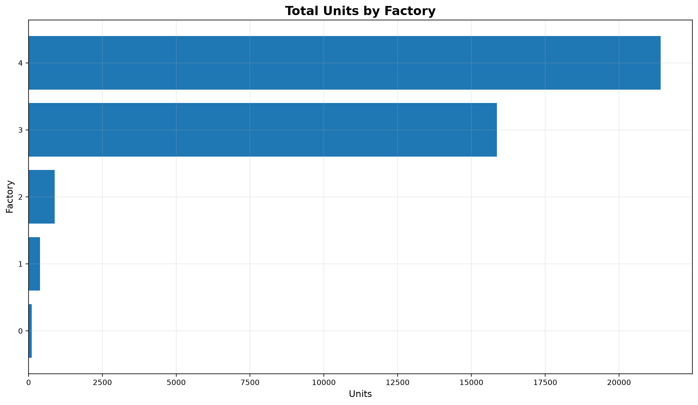
</td>
</tr>
</table>

This section helps understand the distribution of product records and units across the mapped factories.

---

## 💰 5. Sales and Financial Analysis

Financial analysis examines sales revenue, costs, gross profit, and profitability patterns.

### Financial Visualizations

<table>
<tr>
<td width="50%">
<b>05. Factory Sales</b><br/>

</td>
<td width="50%">
<b>06. Factory Gross Profit</b><br/>
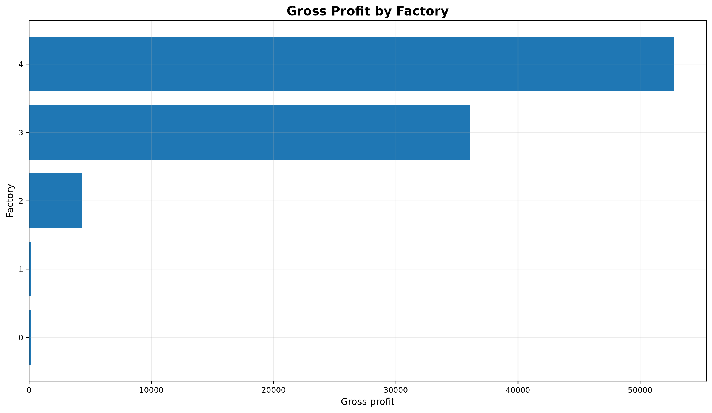
</td>
</tr>
<tr>
<td>
<b>07. Factory Profit Margin</b><br/>

</td>
<td>
<b>08. Sales vs Cost</b><br/>

</td>
</tr>
<tr>
<td>
<b>09. Regional Sales</b><br/>

</td>
<td>
<b>10. Regional Gross Profit</b><br/>

</td>
</tr>
<tr>
<td colspan="2">
<b>11. Financial Correlation Heatmap</b><br/>
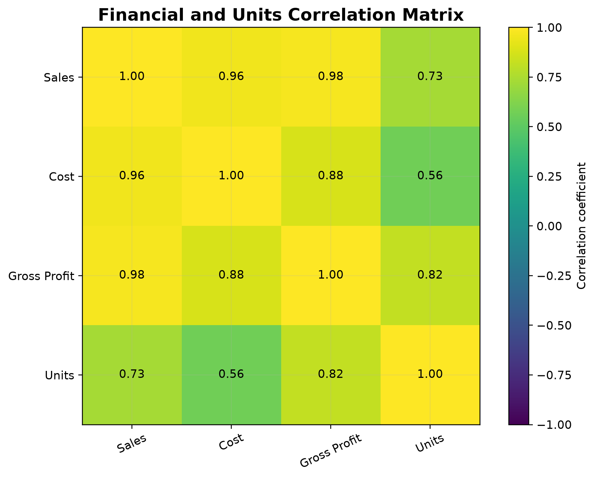
</td>
</tr>
</table>

### Financial Analysis Areas

- Factory-wise sales contribution.
- Gross profit comparison.
- Cost and revenue relationships.
- Regional financial performance.
- Financial variable correlations.

---

## 📦 6. Product, Order and Shipping Analysis

This analysis examines product records, order volume, shipping modes, and distribution patterns.

### Product and Order Visualizations

<table>
<tr>
<td width="50%">
<b>12. Monthly Order Volume</b><br/>

</td>
<td width="50%">
<b>13. Units vs Sales</b><br/>
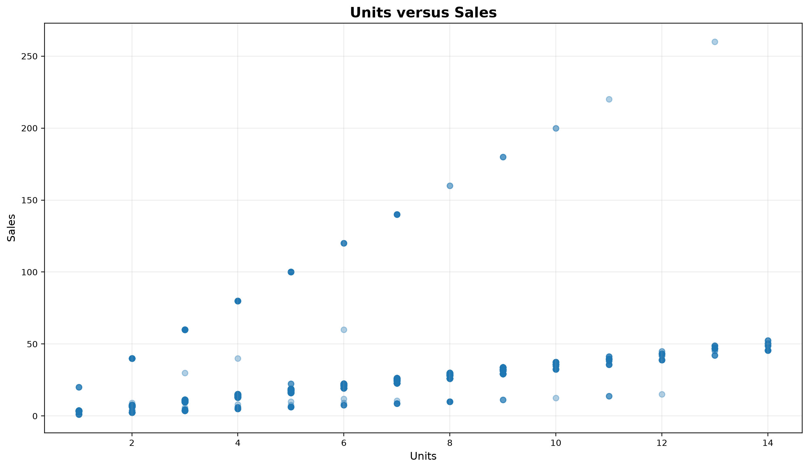
</td>
</tr>
<tr>
<td>
<b>14. Shipping Mode Distribution</b><br/>

</td>
<td>
<b>15. Shipping Mode Sales</b><br/>
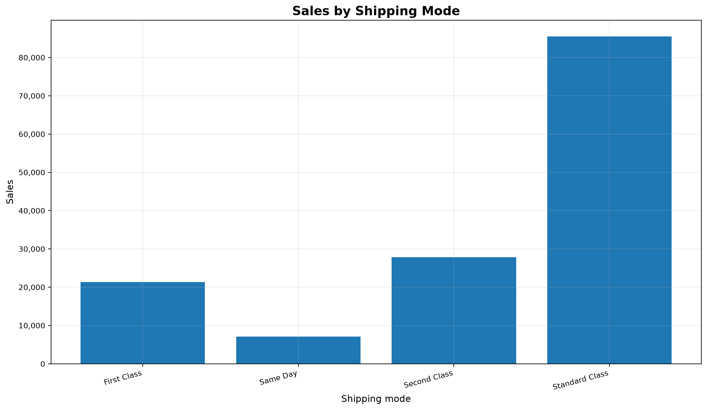
</td>
</tr>
</table>

### Geographic and Distribution Visualizations

<table>
<tr>
<td width="50%">
<b>16. US Regional Distribution</b><br/>
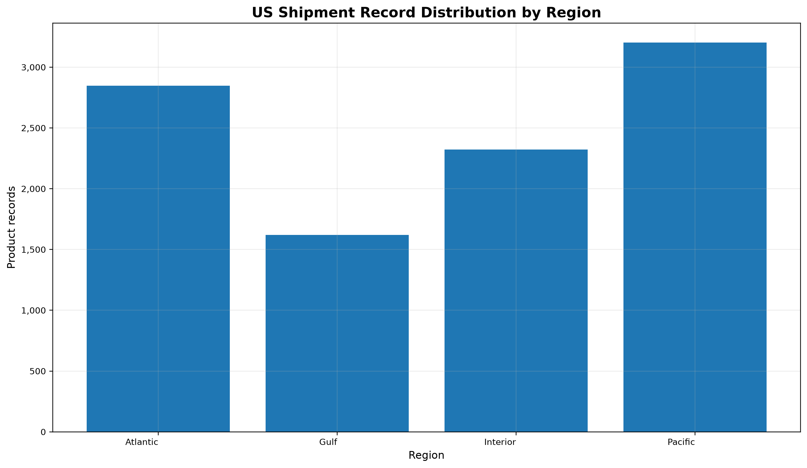
</td>
<td width="50%">
<b>17. US Country Distribution</b><br/>
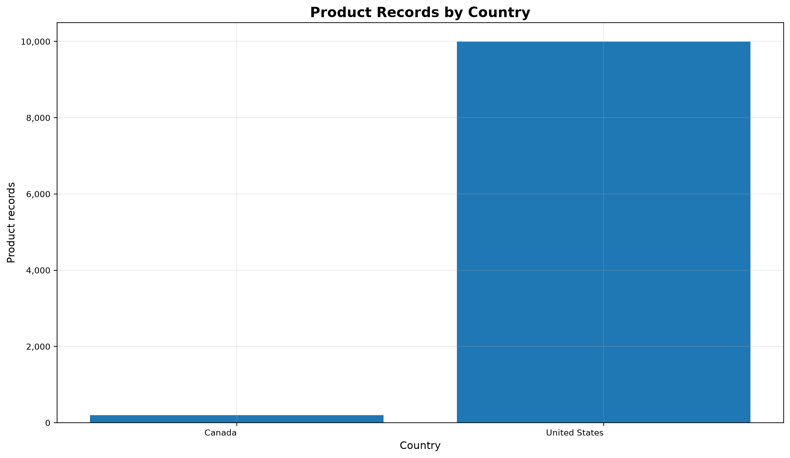
</td>
</tr>
<tr>
<td>
<b>18. Top US States</b><br/>

</td>
<td>
<b>19. Top Factory-State Routes</b><br/>

</td>
</tr>
</table>

---

## 🗺️ 7. Geographic and Distance Analysis

The project explores approximate geographic relationships between mapped factories and customer states.

The methodology uses approximate factory coordinates and US state-centroid coordinates to estimate straight-line distances.

### Geographic Visualizations

<table>
<tr>
<td width="50%">
<b>20. Factory-Customer Network Map</b><br/>
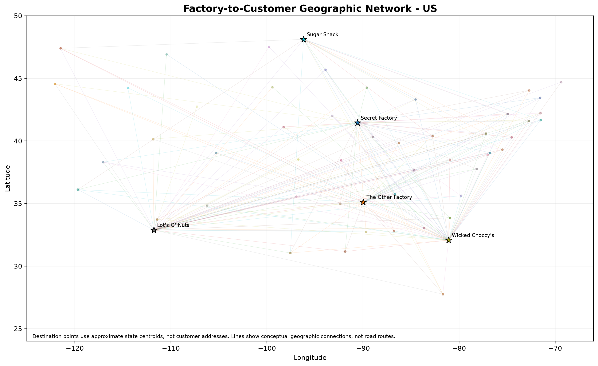
</td>
<td width="50%">
<b>21. Factory-State Distance Heatmap</b><br/>

</td>
</tr>
<tr>
<td>
<b>22. Factory-Region Flow Diagram</b><br/>

</td>
<td>
<b>23. Factory-State Route Pareto</b><br/>

</td>
</tr>
<tr>
<td colspan="2">
<b>24. Top Estimated Factory-State Distances</b><br/>

</td>
</tr>
</table>

**Geographic limitation:** These estimates represent approximate straight-line distances. They are not road distances, actual vehicle routes, or verified customer delivery distances.

---

## ⚠️ 8. Shipping-Date and Data Quality Investigation

Data quality is essential for producing reliable analytical results.

The project investigates the relationship between order dates, shipping dates, calculated date differences, and record identifiers.

### Observed Date Patterns

| Data Quality Metric | Observed Value |
|---|---|
| Order Date range | 2024-01-02 to 2025-12-31 |
| Ship Date range | 2026-06-30 to 2030-06-28 |
| Mean calculated lead time | 1,320.84 days |
| Median calculated lead time | 1,274 days |
| Lead times above 730 days | All records |

### Date Quality Visualizations

<table>
<tr>
<td width="50%">
<b>25. Date Anomaly Distribution</b><br/>
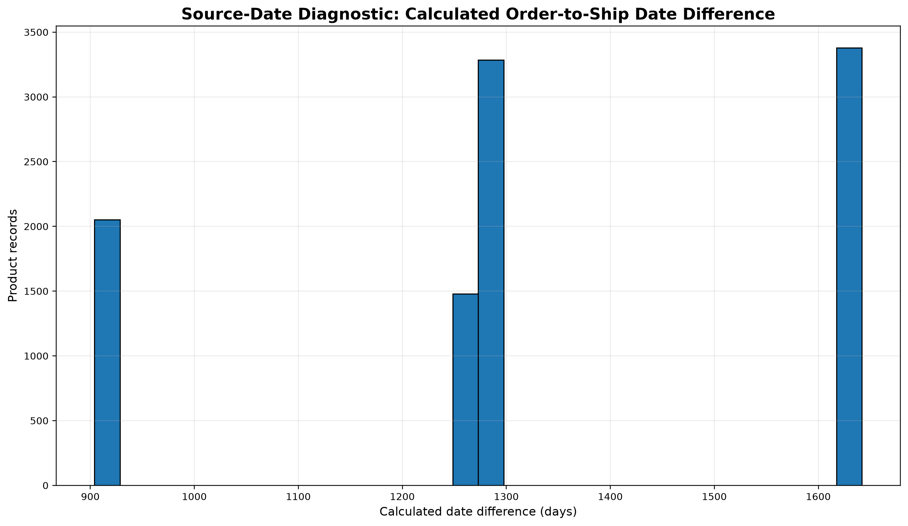
</td>
<td width="50%">
<b>26. Date Anomaly by Year</b><br/>

</td>
</tr>
</table>

### Important Data Quality Findings

- Calculated date differences are unusually large.
- Order ID year tokens do not match Order Date years in 9,994 records where a year token is present.
- Date-related variables show strong correlations with Row ID.
- The underlying cause of these patterns is unknown.

**Interpretation safeguard:** These findings do not establish actual shipping delays, transit times, delivery performance, or transportation efficiency. The source records require verification before operational conclusions can be drawn.

---

## 🔄 9. Project Architecture and Workflow

The project follows a structured data analytics workflow.

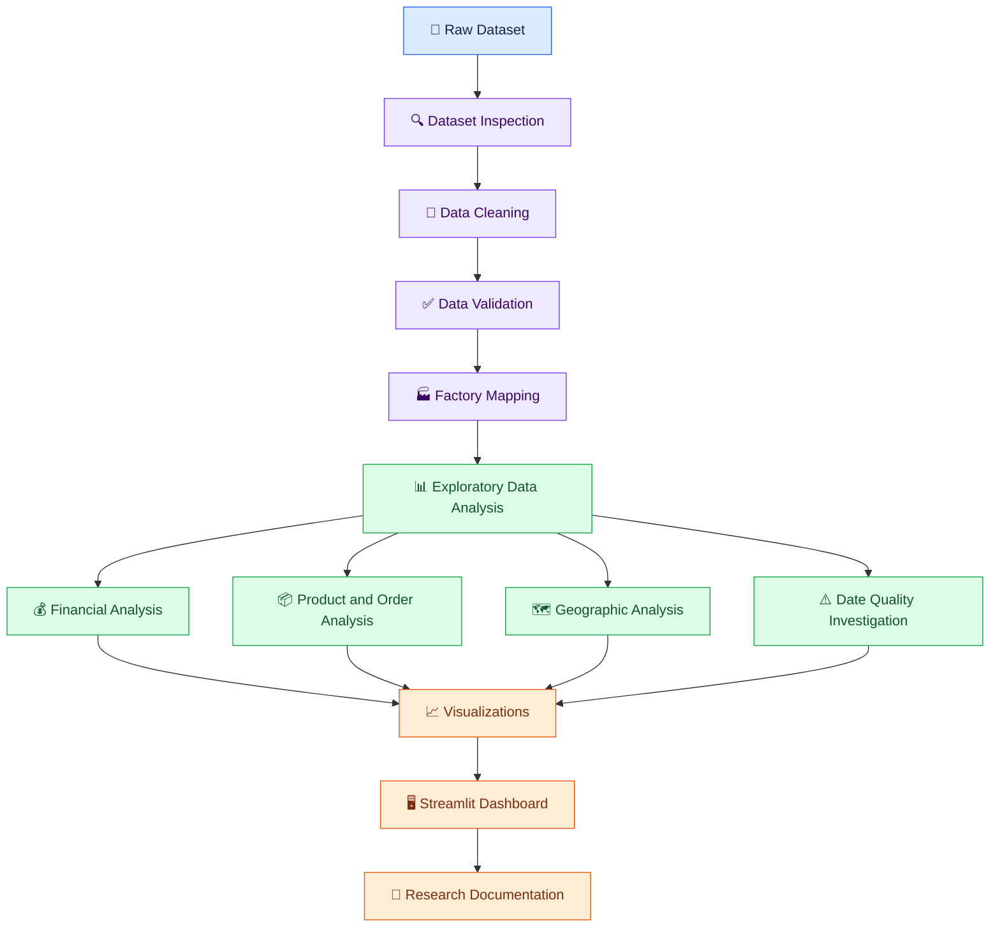

### Project Diagrams

<table>
<tr>
<td width="50%">
<b>01. Project Workflow</b><br/>
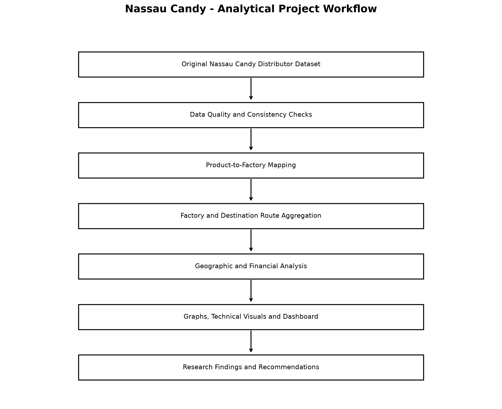
</td>
<td width="50%">
<b>02. Data Architecture</b><br/>

</td>
</tr>
<tr>
<td>
<b>03. Route Methodology</b><br/>

</td>
<td>
<b>04. Date Quality Safeguard</b><br/>
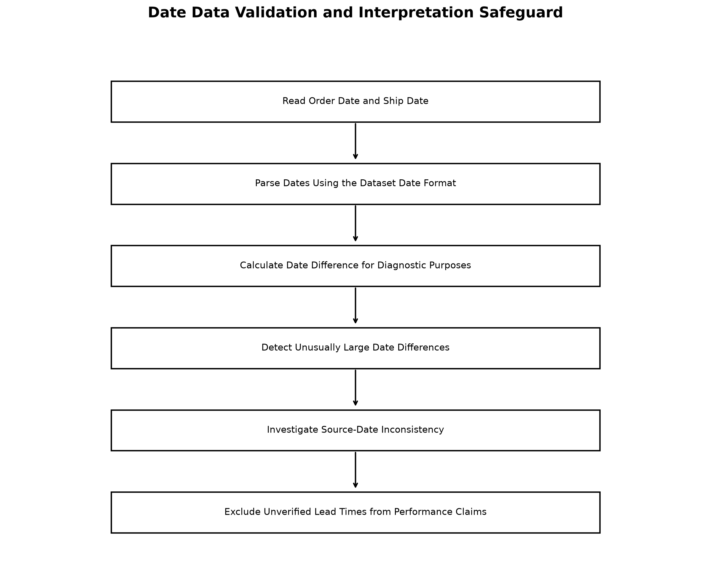
</td>
</tr>
</table>

---

## 🛠️ 10. Technologies Used

<p align="center">
  
</p>

| Technology | Application |
|---|---|
| Python | Data analysis and processing |
| Pandas | Data manipulation |
| NumPy | Numerical computation |
| Matplotlib | Data visualization |
| Seaborn | Statistical visualization |
| Plotly | Interactive visualization components |
| Streamlit | Interactive dashboard |
| Git | Version control |
| GitHub | Repository hosting and documentation |

---

## 📁 11. Repository Structure

```text
Nassau-Candy-Shipping-Analysis/
│
├── dashboard/
│   ├── app.py
│   └── requirements.txt
│
├── data/
│   ├── processed/
│   └── original/
│
├── images/
│   ├── dashboard_illustrations/
│   ├── historical_candy_references/
│   ├── product_assortment/
│   ├── supply_chain/
│   └── transportation/
│
├── outputs/
│   ├── charts/
│   └── diagrams/
│
├── research_paper/
│   └── RESEARCH_PAPER.md
│
├── src/
│   └── Python analysis scripts
│
├── reports/
├── tests/
├── README.md
└── requirements.txt
```

---

## ▶️ 12. Run the Project Locally

### Prerequisites

- Python 3.10 or later
- pip
- Git

### Step 1: Clone the Repository

```bash
git clone https://github.com/snehassneha4578-collab/Nassau-Candy-Shipping-Analysis.git
```

### Step 2: Navigate to the Project

```bash
cd Nassau-Candy-Shipping-Analysis
```

### Step 3: Install Dependencies

```bash
pip install -r dashboard/requirements.txt
```

### Step 4: Run the Streamlit Dashboard

```bash
streamlit run dashboard/app.py
```

Open the local dashboard:

```text
http://localhost:8501
```

---

## 📄 13. Research Paper

### Factory-to-Customer Shipping Route Efficiency Analysis for Nassau Candy Distributor

The research paper documents the project's analytical methodology, dataset characteristics, geographic analysis, financial patterns, and data-quality limitations.

<p align="center">
  <a href="research_paper/RESEARCH_PAPER.md">
    
  </a>
</p>

**Document:** `research_paper/RESEARCH_PAPER.md`

*Research status: Project research draft; not represented as a published or peer-reviewed academic paper.*

---

## 🔮 14. Future Improvements

- Verify unusual date patterns against source-system records.
- Incorporate verified shipment-level tracking data.
- Integrate actual customer geographic coordinates.
- Explore road-network distance calculations.
- Extend predictive analysis after validating the underlying data.
- Enhance interactive dashboard reporting.
- Introduce additional automated data-quality checks.

---

## 🏁 15. Conclusion

The Nassau Candy Distributor Shipping Analysis project demonstrates the application of Python and data analytics to a distribution and supply chain dataset.

By combining data preparation, exploratory data analysis, financial evaluation, factory mapping, geographic estimation, statistical investigation, and interactive dashboard development, the project provides a structured understanding of the available business data.

A key outcome is the identification of unusual date patterns and data-quality limitations. This demonstrates the importance of validating source information before drawing operational conclusions.

The project provides a foundation for further analytical development using verified shipping and distribution data.

---

## 👩‍💻 About the Developer

**Sneha S**

Electronics and Communication Engineering Student | Data Analytics | Python | AI/ML

Interested in building practical technology solutions through data analytics, artificial intelligence, and software development.

<p align="center">
  <a href="https://github.com/snehassneha4578-collab">
    
  </a>
</p>

---

<p align="center">
  <b>🍬 Nassau Candy Distributor Shipping Analysis</b><br/>
  <i>Data • Insights • Visualization • Better Decisions</i>
</p>
