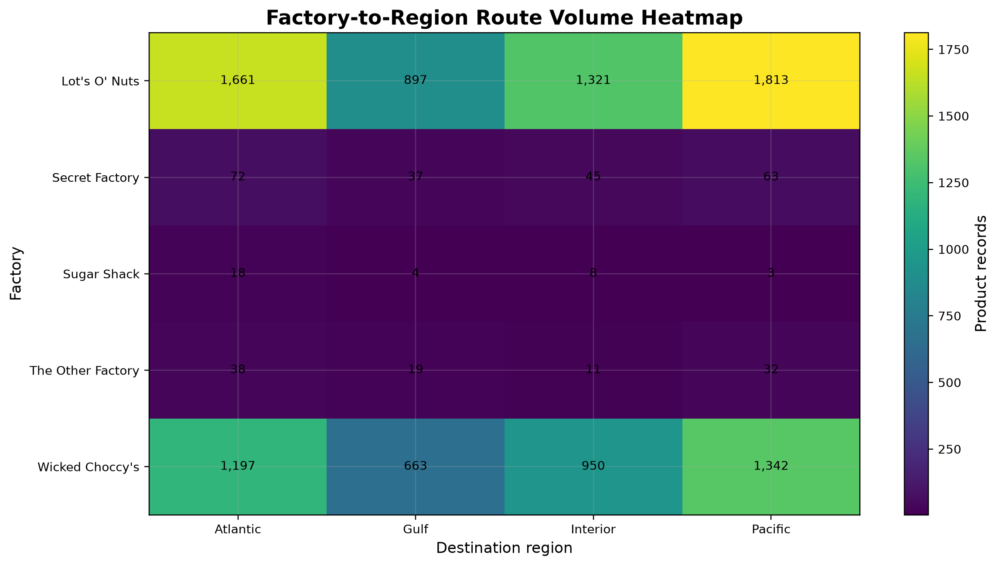
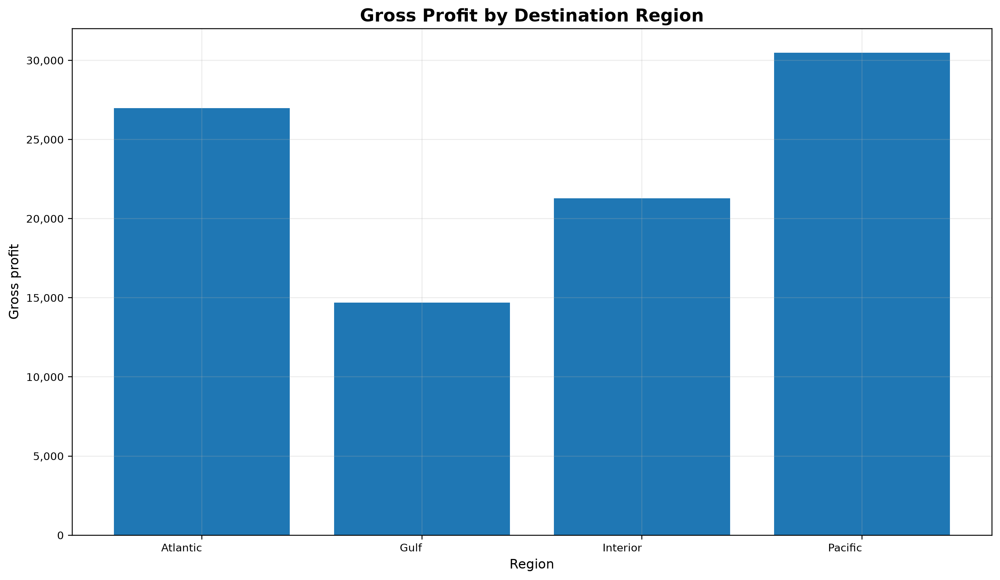
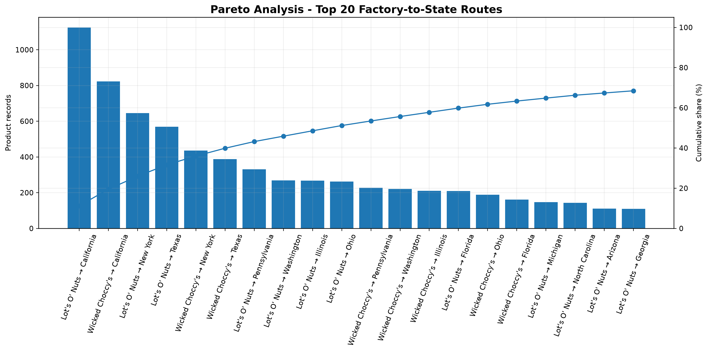

# 🍬 Factory-to-Customer Shipping Route Efficiency Analysis
### Nassau Candy Distributor | Supply Chain Analytics | Business Intelligence

<p align="center">
  <a href="YOUR_DEPLOYED_STREAMLIT_URL">
    
  </a>
  <a href="https://github.com/snehassneha4578-collab/Nassau-Candy-Shipping-Analysis">
    
  </a>
</p>

<p align="center">
  
  
  
  
  
</p>

---

## 📌 1. Project Overview

The **Factory-to-Customer Shipping Route Efficiency Analysis** project explores the relationship between factory assignments, customer geography, shipping modes, product distribution, financial performance, and estimated factory-to-state distances using the Nassau Candy Distributor dataset.

The project applies Python-based data analytics and visualization techniques to transform raw business data into meaningful analytical insights.

The analysis focuses on understanding how products are distributed across factories, identifying geographic patterns, examining shipping methods, comparing financial performance, and estimating approximate geographic distances.

**Project Goal:** Build a data-driven analytical solution that helps explore supply-chain distribution patterns and supports business intelligence.

## 🎯 2. Project Objectives

- Analyze product distribution across manufacturing factories.
- Understand customer distribution across geographic regions.
- Examine shipping-mode usage and sales patterns.
- Evaluate factory-level sales, costs, and gross profit.
- Estimate approximate factory-to-state geographic distances.
- Investigate unusual order and shipping date patterns.
- Develop visual reports and an interactive Streamlit dashboard.

## 📊 3. Dataset Overview

The analysis uses the Nassau Candy Distributor dataset.

| Metric | Value |
|---|---:|
| Product-level records | 10,194 |
| Unique orders | 8,549 |
| Products | 15 |
| Mapped factories | 5 |
| Unmapped product records | 0 |
| Multi-factory orders | 0 |

**Important data interpretation:** Each row represents a product-level record. The 10,194 records must not be interpreted as 10,194 unique shipments.

## 🏭 4. Factory Distribution Analysis

Factory distribution analysis examines how product records are assigned across the five mapped factories.

| Factory | Product Records |
|---|---:|
| Lot's O' Nuts | 5,692 |
| Wicked Choccy's | 4,152 |
| Secret Factory | 217 |
| The Other Factory | 100 |
| Sugar Shack | 33 |
| **Total** | **10,194** |

### Factory Distribution Chart

This chart compares the number of product-level records associated with each factory.


**Analytical interpretation:** Lot's O' Nuts and Wicked Choccy's account for most of the product records. The remaining factories have substantially smaller record counts.

**Business relevance:** This comparison helps identify how the dataset's product distribution is concentrated across factory assignments.

## 🌎 5. Geographic Distribution Analysis

Geographic distribution analysis studies how customer records are spread across regions, states, and countries.

### 5.1 US Regional Distribution

This visualization compares the distribution of customer records across US geographic regions.


**Why it matters:** Regional distribution can help identify geographic concentration and support exploratory regional planning.

### 5.2 Country Distribution

This chart displays the distribution of records by country.


**Why it matters:** Country-level analysis provides a broader view of the geographic coverage represented in the dataset.

### 5.3 Top US States

This chart identifies the states with the highest representation in the dataset.


**Why it matters:** State-level distribution helps identify important customer markets for further analysis.

### 5.4 Factory-to-Region Heatmap

A heatmap uses color intensity to represent the magnitude of values across categories.

This visualization compares factory distribution across geographic regions.



**Why it matters:** It helps compare the geographic distribution patterns associated with different factory assignments.

## 🚚 6. Shipping Mode Analysis

A shipping mode refers to the transportation method recorded for moving products, such as different carrier or delivery service categories.

### 6.1 Shipping Mode Distribution

This chart compares the representation of shipping modes in the dataset.


**Analytical purpose:** Understand which shipping modes appear more frequently in the available records.

### 6.2 Shipping Mode Sales

This visualization compares sales associated with the different shipping modes.


**Business relevance:** It provides a financial perspective on shipping-mode usage. Sales associated with a shipping mode do not independently establish its transportation cost or delivery performance.

## 🍫 7. Product Distribution Analysis

Product distribution analysis examines how different products contribute to the dataset.

### Product Distribution


**Analytical interpretation:** The chart compares product-level representation and helps identify products with relatively higher or lower record counts.

**Business relevance:** Product distribution can support exploratory inventory and factory-assignment analysis.

## 💰 8. Financial Performance Analysis

Financial analysis examines sales, cost, gross profit, profit margin, and relationships between financial variables.

### Important Definitions

| Term | Definition |
|---|---|
| Sales | Revenue recorded from product transactions. |
| Cost | Recorded product cost associated with transactions. |
| Gross Profit | Sales minus cost. |
| Profit Margin | Gross profit expressed as a percentage of sales. |
| Correlation | A statistical measure of the relationship between two variables. |

### 8.1 Factory Sales

This chart compares sales across the five factories.


**Why it matters:** Factory-level sales comparisons help explore the distribution of recorded revenue.

### 8.2 Factory Gross Profit

Gross profit represents the difference between sales and cost.


**Why it matters:** It helps compare the recorded gross profit associated with each factory.

### 8.3 Factory Profit Margin

Profit margin expresses gross profit relative to sales.


**Formula:** Profit Margin = (Gross Profit / Sales) × 100

**Why it matters:** This measure helps compare profitability relative to revenue rather than relying only on total sales.

### 8.4 Sales vs Cost

This visualization compares sales and cost values.


**Why it matters:** Comparing these measures helps explore the financial relationship between revenue and recorded costs.

### 8.5 Regional Gross Profit

This chart compares gross profit across geographic regions.



**Why it matters:** It provides a regional perspective on recorded financial performance.

### 8.6 Units vs Sales

This chart examines the relationship between the number of units and sales.


**Why it matters:** It helps explore whether higher recorded unit quantities are associated with higher sales.

### 8.7 Financial Correlation Heatmap

Correlation measures the strength and direction of a statistical relationship between variables.


**Why it matters:** This visualization helps identify relationships among the available financial variables. Correlation does not establish causation.

## 📅 9. Order Volume and Date Quality Analysis

### 9.1 Monthly Order Volume

This chart explores the distribution of recorded orders across months.


**Why it matters:** Monthly patterns can help describe the distribution of order activity over time. The unusual date fields should be considered when interpreting time-based results.

### 9.2 Date Quality Investigation

| Metric | Observed Value |
|---|---|
| Order Date range | 2024-01-02 to 2025-12-31 |
| Ship Date range | 2026-06-30 to 2030-06-28 |
| Mean calculated lead time | 1,320.84 days |
| Median calculated lead time | 1,274 days |
| Lead times above 730 days | All records |

**Calculated lead time** is the difference between the recorded Ship Date and Order Date.

The observed date patterns are unusual. Their root cause is unknown and requires verification against the original source system.

These calculated differences must not be interpreted as actual shipping delays, transit time, or delivery performance.

### 9.3 Date Anomaly Distribution


**Why it matters:** This chart helps examine the distribution of unusual date patterns in the dataset.

### 9.4 Date Anomaly by Year


**Why it matters:** This visualization helps explore how recorded date anomalies are distributed across years.

## 🗺️ 10. Geographic Route and Distance Analysis

This section explores approximate geographic relationships between factory locations and customer states.

**Distance estimation definition:** A straight-line geographic estimate between two coordinate locations. It does not represent the actual road distance or vehicle route.

### 10.1 Factory-Customer Network Map

A network map represents geographic locations and their relationships using visual connections.


**Why it matters:** It provides a visual overview of the approximate geographic relationships represented in the analysis.

### 10.2 Factory-State Distance Heatmap

This heatmap compares estimated straight-line distances between factory locations and state-centroid locations.


**Why it matters:** It supports geographic comparison between factories and customer-state locations.

### 10.3 Factory-Region Flow Diagram

A flow diagram illustrates relationships and movement between categories or stages.


**Why it matters:** It provides a visual representation of the factory-to-region distribution structure.

### 10.4 Factory-State Route Pareto Analysis

Pareto analysis ranks categories by their contribution to a measured quantity and can help identify the most significant categories.



**Why it matters:** It helps identify the factory-state combinations that contribute most to the analyzed route metric.

### 10.5 Top Factory-State Routes

This chart compares the most represented factory-state combinations.


**Why it matters:** It helps identify prominent factory-state relationships in the available records.

### 10.6 Top Estimated Factory-State Distances

This chart displays the largest estimated straight-line distances in the analysis.


**Why it matters:** It highlights geographically distant factory-state combinations for further investigation. These are estimates, not verified delivery routes.

## 🧩 11. Project Architecture and Workflow Diagrams

The following diagrams explain how the analytical solution is organized.

### 11.1 Project Workflow

Shows the overall sequence from dataset inspection through data processing, analysis, visualization, and reporting.


### 11.2 Data Architecture

Illustrates the organization of source data, processed datasets, analytical outputs, and dashboard components.


### 11.3 Route Estimation Methodology

Explains the geographic estimation approach used to compare factory coordinates with approximate customer-state locations.


### 11.4 Date Quality Safeguard

Explains how unusual date patterns are investigated and why calculated lead times are not treated as verified transportation performance.


## 🖥️ 12. Interactive Streamlit Dashboard

The project includes a Streamlit dashboard for exploring analytical outputs through an interactive interface.

### Dashboard Capabilities

- Explore factory-level distribution.
- Examine geographic distribution patterns.
- Compare shipping modes.
- Review product-level analysis.
- Explore financial performance.
- Examine route and distance estimates.
- Investigate date-quality patterns.
- View analytical charts and reports.

### Run the Dashboard Locally

Install dependencies:

```bash
pip install -r dashboard/requirements.txt
```

Start the application:

```bash
streamlit run dashboard/app.py
```

The application will provide a local URL in the terminal.

**Live dashboard:** Replace `YOUR_DEPLOYED_STREAMLIT_URL` in the badge at the top with the actual deployed public URL.

## 🛠️ 13. Project Structure

```text
Nassau-Candy-Shipping-Analysis/
│
├── data/
│   ├── original/
│   └── processed/
│
├── dashboard/
│   ├── app.py
│   └── requirements.txt
│
├── images/
│   ├── company_background/
│   ├── dashboard_illustrations/
│   ├── historical_candy_references/
│   ├── product_assortment/
│   ├── supply_chain/
│   └── transportation/
│
├── outputs/
│   ├── charts/
│   ├── diagrams/
│   └── reports/
│
├── src/
│   ├── generate_all_graphs.py
│   └── generate_advanced_visuals.py
│
├── tests/
│   └── validate_project.py
│
├── README.md
└── requirements.txt
```

## ✅ 14. Project Validation

The project includes a validation script to check important project components and data outputs.

Run the validation script from the project root:

```bash
python tests/validate_project.py
```

## ⚠️ 15. Data Limitations

- Product-level records are not shipment-level records.
- Customer delivery coordinates are unavailable.
- Factory coordinates and state-centroid coordinates are approximate.
- Distance estimates represent straight-line geographic distances.
- Actual road distances and vehicle routes are not available.
- Date anomalies require verification against original source-system records.
- Illustrative images do not verify actual Nassau Candy facilities.
- Actual delivery performance cannot be established from this dataset.
- Correlation results do not establish causal relationships.

## 🚀 16. Future Improvements

- Obtain verified customer delivery coordinates.
- Integrate road-network routing services.
- Validate order and shipping dates against source-system records.
- Obtain shipment-level tracking information.
- Improve geographic route analysis.
- Extend dashboard functionality and interactive filtering.
- Add automated testing and reporting capabilities.
- Explore predictive analytics after validating data quality.

## 🏁 17. Conclusion

This project demonstrates the application of Python-based data analytics, geographic estimation, financial analysis, and business intelligence techniques to the Nassau Candy Distributor dataset.

It provides an exploratory view of factory distribution, customer geography, shipping modes, product patterns, financial performance, and approximate geographic relationships.

The project also emphasizes the importance of data quality, transparent methodology, and responsible interpretation of analytical results.

---

<p align="center">
  <b>🍬 Nassau Candy Distributor Shipping Analysis</b>
  <br/>
  Data Analytics | Supply Chain Analytics | Business Intelligence
</p>
